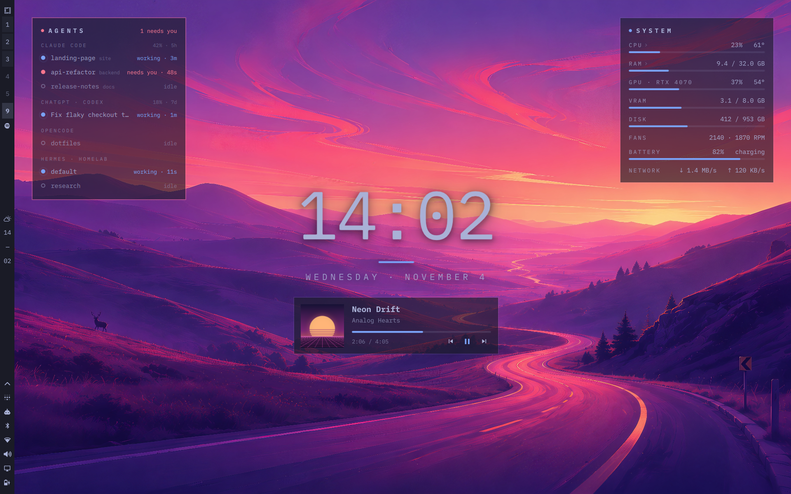
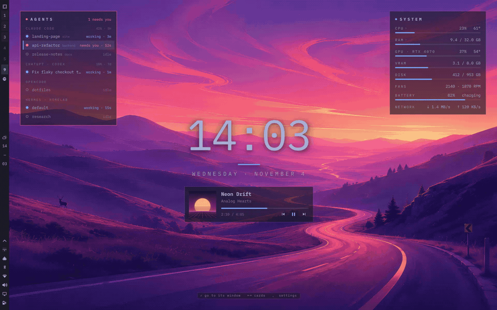
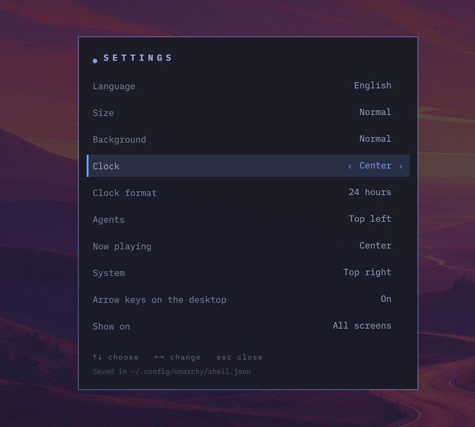

<div align="center">

# Eyemarchy

**Your empty desktop, alive.**

Live AI agents, now playing, system and a big clock on your [Omarchy](https://omarchy.org) desktop.
Keyboard-first, painted in your theme, and one shortcut away when your windows cover it.

[](https://github.com/Harold15000/eyemarchy/actions/workflows/ci.yml)




</div>

## Why

You run three Claude Code sessions, a Codex thread and a Hermes agent on your
server. One of them is waiting for your approval, and you only find out ten
minutes later. Eyemarchy puts all of them on your desktop with what each one
is doing, turns the card red when an agent **needs you**, and takes you to its
window with one key.

## What you get

| | |
|---|---|
| **Agents** | Every AI coding agent on the machine: working, **needs you** (Claude Code) or idle, with how long. Enter jumps to its terminal; background Claude Code sessions open with `claude attach`. Agents you run over SSH (Hermes, Claude Code…) show up too, by host. Plan usage from Omarchy's own Agents widget, when you have it. |
| **Now playing** | Any MPRIS player: Spotify, a browser tab, mpv. Cover, progress, controls, and switching between several sources. Enter takes you to the player. |
| **System** | CPU and temperature, RAM, GPU (NVIDIA without waking a sleeping card, AMD), VRAM, disks, fans, battery and network. CPU and RAM unfold into the apps using them, and you can close one from there (it asks first). |
| **Clock** | Big, centered, with the date in your language. 24 or 12 hours, any Qt format. |

- **Keyboard-first.** On an empty desktop the arrow keys move between cards, Enter goes, Space plays or pauses. `SUPER + ALT + D` brings everything over your windows.
- **Yours.** Every card can go to any corner, top, bottom or center, or be hidden. Size, background, language, screens: change them in a settings panel, no JSON needed.
- **Native.** It is an Omarchy shell plugin: it follows your theme, font and bar position the moment you change them.
- **Private.** Everything is read locally from `/proc`, `/sys` and the agents' own state files. No network, no telemetry, no conversation content.

<div align="center">

</div>

## Install

```bash
omarchy plugin add https://github.com/Harold15000/eyemarchy --enable
```

That is it: the widgets appear on your desktop. Requirements: Omarchy 4 (the
Quickshell shell). Nothing else to install: it uses the Python that ships with
Omarchy, and `nvidia-smi` only if you have an NVIDIA card.

### Keyboard shortcuts (recommended)

Add these two lines to `~/.config/hypr/bindings.lua`:

```lua
o.bind("SUPER + ALT + D", "Eyemarchy over windows", "omarchy-shell -q eyemarchy toggle")
o.bind("SUPER + D", "Hide or show Eyemarchy", "omarchy-shell -q eyemarchy toggleHidden")
```

Omarchy does not use either combination by default. Pick others if you like.

## Use it

| Where | Key | Does |
|---|---|---|
| Empty desktop or summoned | `← →` | Move between cards |
| | `↑ ↓` | Move inside a card (in Now playing alone: switch source) |
| | `Enter` | Go to the agent's window · open the player · unfold CPU/RAM · close an app (asks first) |
| | `Space` | Play / pause |
| | `[` `]` | Switch the music source |
| | `,` | Settings |
| | `Esc` | Clear the selection · fold the list · put the widgets back |
| Anywhere | `SUPER + ALT + D` | Widgets over your windows |
| | `SUPER + D` | Hide or show the widgets (the clock and music stay) |

Everything works with the mouse too: click any row.

## Make it yours

Press `,` on the desktop (or run `omarchy-shell eyemarchy settings`) for the
settings panel: language, size, background, where each card goes, 12 or 24
hours, arrow keys on or off, all screens or only the focused one. Changes save
at once.

<div align="center">

</div>

Everything else lives in your plugin entry in `~/.config/omarchy/shell.json`.
Write only what you want to change; the shell reloads it on save:

```jsonc
"plugins": [
  {
    "id": "io.github.harold15000.eyemarchy",
    "scale": 1.15,
    "agents": { "position": "top-right", "hide": ["gemini"] },
    "system": { "position": "bottom-right", "rows": ["cpu", "ram", "gpu", "battery"] },
    "clock": { "timeFormat": "h:mm AP", "size": 110 }
  }
]
```

<details>
<summary><b>Every setting</b></summary>

| Key | Default | |
|---|---|---|
| `language` | `"auto"` | `"auto"` follows your system, or `"en"`, `"es"` |
| `scale` | `1` | 0.7 – 1.6, on top of your Omarchy font size |
| `opacity` | `0.62` | Card background, 0.2 – 1 |
| `margin` | `28` | Distance from the screen edges, in px |
| `screens` | `"all"` | `"all"`, `"focused"` or a list such as `["DP-1"]` |
| `keyboard` | `true` | Arrow keys on an empty desktop |
| `hideKeeps` | `["clock", "media"]` | What stays when you hide the widgets |
| `clock.position` | `"center"` | `top-left`, `top-center`, `top-right`, `center`, `bottom-left`, `bottom-center`, `bottom-right` or `off` |
| `clock.timeFormat` | `"HH:mm"` | [Qt format](https://doc.qt.io/qt-6/qml-qtqml-qt.html#formatDateTime-method): `"h:mm AP"` for 12 hours, `"HH:mm:ss"` with seconds |
| `clock.dateFormat` | `""` | `""` is the language default, e.g. `"dddd · MMMM d"` |
| `clock.showDate` | `true` | |
| `clock.size` | `132` | Size of the time, in px |
| `clock.offset` | `-40` | Vertical offset of the center column |
| `agents.position` | `"top-left"` | Any slot, or `off` |
| `agents.maxPerGroup` | `5` | Rows per agent before "+N more" |
| `agents.showWhenEmpty` | `true` | Keep the card when nothing runs |
| `agents.hide` | `[]` | Groups to leave out: `claude`, `codex`, `opencode`, `gemini`, `hermes`, `remote`, … |
| `agents.custom` | `[]` | Your own agents: `[{ "name": "My agent", "match": "regex on the command line" }]` or `{ "name": …, "process": "program-name" }` |
| `agents.remote` | `true` | Agents started over SSH |
| `agents.usage` | `true` | Plan usage from Omarchy's Agents widget |
| `media.position` | `"center"` | In the center it sits under the clock |
| `media.hideWhenPaused` | `false` | |
| `system.position` | `"top-right"` | Any slot, or `off` |
| `system.rows` | all | Order and choice of `cpu`, `ram`, `gpu`, `vram`, `disk`, `fans`, `battery`, `net` |
| `system.disks` | `[]` | Mount points; empty is `/` (plus `/home` if it is a separate disk) |
| `system.warnPercent` | `85` | Bars turn urgent above this |
| `system.warnTemp` | `85` | Temperatures turn urgent above this |
| `system.allowClose` | `true` | Close or force-quit apps from the CPU and RAM lists |

</details>

## Supported agents

| Agent | How it is detected | States |
|---|---|---|
| Claude Code | `~/.claude/sessions` (honours `CLAUDE_CONFIG_DIR`) | working · **needs you** · idle; background sessions open with `claude attach` |
| Codex CLI and the ChatGPT app | `~/.codex/state_*.sqlite` (honours `CODEX_HOME`) and the `codex` engine | working · idle, with thread titles |
| opencode · Gemini CLI · Grok · Antigravity · Hermes · Aider · Amp · Crush · Goose · Cursor Agent · Qwen Code · Copilot CLI · Droid · Kimi CLI · Pi | the process and the CPU it uses | working · idle |
| Anything over SSH | `ssh host … <agent>`, tmux sessions included, by the bytes it receives | working · idle |
| Your own | `agents.custom` | working · idle |

Missing yours? It is one line in `scripts/agents.py`: open an issue or a pull request.

## Hardware

Built to work on any Omarchy machine. Rows the machine does not have are simply left out.

| | |
|---|---|
| CPU temperature | Intel (`coretemp`), AMD (`k10temp`, `zenpower`), ARM and ACPI thermal zones |
| GPU | NVIDIA (through `nvidia-smi`, only when the card is already awake, so it never costs battery) and AMD (`amdgpu`). Intel integrated graphics have no usage counter without root, so the row is hidden |
| Fans | Any `hwmon` fan sensor (laptops and desktops) |
| Battery | Laptop batteries; mice and headsets are ignored |
| Screens | Every monitor, any scale, the bar on any side |

## Privacy and safety

- No network access at all. No telemetry.
- It reads process names, CPU counters and the agents' status files. It never reads conversations; the only text it shows from an agent is the title of recent Codex threads.
- Closing an app only ever sends a signal to *your* processes, checks the process is still the same one (by its start time), and refuses the compositor, the shell, audio and the session. It asks before closing, and offers a force quit only if the app does not respond.
- No root, no extra packages, no background services: it runs inside the Omarchy shell and stops with it.

## Uninstall

```bash
omarchy plugin remove io.github.harold15000.eyemarchy
```

Then delete the two `o.bind(...)` lines from `~/.config/hypr/bindings.lua` if
you added them. The only file it keeps is `~/.local/state/io.github.harold15000.eyemarchy/state.json`
(whether the widgets are hidden); remove that folder too if you want.

## Troubleshooting

- **Nothing shows up.** `omarchy plugin list` should list it as enabled; `omarchy-shell eyemarchy state` prints what it sees.
- **Arrow keys do nothing.** They only act on an empty desktop of the focused screen, and step aside when a menu is open. Check `keyboard` is `true`.
- **An agent is missing.** Run `python3 ~/.config/omarchy/plugins/io.github.harold15000.eyemarchy/scripts/agents.py` and open an issue with the output.
- **Try it without agents.** `omarchy-shell eyemarchy demo on` fills the cards with sample data; `demo off` goes back.

## Contributing

Translations, agents and hardware fixes are very welcome. See [CONTRIBUTING.md](CONTRIBUTING.md).

## License

[MIT](LICENSE) © Harold Jimenez
